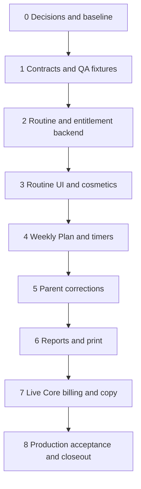

# Routine-First Product Direction — Execution And Production Plan

Created: 2026-10-12

Status: Execution started 2026-10-12. Phase 0 baseline/decisions and Phase 1 contracts/runtime QA are locally verified; Cloudflare metadata is pending and production rollout has not started. Live state and accepted decisions: [execution workflow](product-direction-execution/workflow-plan.md), [decision log](product-direction-execution/decisions.md).

Source: [September working notes](../product-direction-working-notes-2026-09.md). The original note is preserved. The user authorized beginning execution on 2026-10-12; recommended defaults are recorded in the decision log.

## Outcome And Scope

Ship Own Path around school planning/student work and Daily Routines. Completion means the accepted changes are running on the production public and dashboard hosts, the trusted Firebase backend and billing agree with the UI, historical household data survives, and production acceptance evidence exists. A merged PR, preview deployment, static contract check, or sandbox payment alone does not meet that bar.

This release includes:

- A complete Free daily-routine loop: Morning/Afternoon/Evening, reliable points, usable avatars, cosmetic unlocks, and persisted selection.
- Hidden weekly/monthly chore, allowance, bounty, and broad reward-economy surfaces, with preserved records and compatibility behavior.
- Separate Save Draft, Save as Default Week, and Publish This Week actions with correct persistence and clear status.
- Conditional timers and direct completion for non-timed blocks.
- Auditable parent completion/undo from existing Students controls and contextual weekly-plan/report views.
- Clear reports and verified printed records that preserve correction history.
- Free with explicit scale limits; Core at $5/month with unlimited students and active curriculum; Lockdown presented as a later tier.
- Working self-service Core subscription purchase and management in live mode, migration of existing entitlements, production verification, and rollback instructions.

Full Lockdown commercialization, kiosk development, AI, mobile/PWA work, projects, first-class curriculum/assignment redesign, a new Evidence Drawer, and a general report-compliance certification are separate workstreams. Existing Lockdown accounts and extension behavior must continue working. Existing evidence references remain supported, but this release does not promise new attachment upload functionality.

## Findings That Change The Implementation Approach

Reviewed baseline: Git commit `e3120e1c16a2920b2d062ed18012345040188ac3`. The attached worktree and the source repository had the same HEAD at review time; the source working note was untracked. A verbatim copy is included in this worktree so the plan and its source can travel together.

| Finding | Evidence | Execution implication |
| --- | --- | --- |
| The dashboard already has nested routes, a registry, and domain hooks. | `src/constants/dashboardFeatures.js`, `src/pages/dashboard/`, `src/hooks/` | Extend these boundaries; do not rebuild the shell from the older AGENTS.md description. |
| Save Draft currently replaces the same student-week record and can change a published plan back to draft. | `src/hooks/useWeeklyPlanRecord.js`, `WeeklyPlanReviewPanel.handleSaveDraft` | Introduce separate private draft state before promising that student work stays unchanged. |
| Default-week saving currently updates subject-level default quantities, including multi-student subjects. | `WeeklyPlanReviewPanel.handleSaveAsDefaultWeek` | Explicitly define student versus shared scope; make saves atomic and avoid leaking one student's defaults into another's. |
| Parent completion creates a manual submission; undo deletes the submission. | `src/hooks/useWeeklyActivity.js` | Replace both paths with a trusted, auditable correction contract. |
| Submission creation is public; update/delete currently accepts any authenticated user. | `firestore.rules` | UI-only audit markers are forgeable. Protect correction authority and affected write paths with rules/callable tests. |
| Routine points already use one idempotent full-day source, `routine_day:<date_key>`. | `functions/src/index.js`, `awardTrustedPointsForRoutineDay` | Reuse this model rather than introducing item/period awards. |
| Rewards are paid-only in client and backend catalogs; Free student responses omit wallets/rewards. | `src/constants/entitlements.js`, `functions/src/index.js`, `useStudentChores` | Free routine rewards need a scoped entitlement and response migration, not just navigation changes. |
| Avatar choices currently provide placeholder previews without trusted persistence. | `src/components/student/StudentAvatarWorkspace.jsx`, [seeded portal QA](../support/student-portal-seeded-e2e-2026-08-19.md) | Final usable catalog assets, unlocks, and persisted selection are release deliverables. |
| Core and Lockdown each cap students at 10; unlimited uses `null`. | Client catalog and backend `PLAN_LIMITS` | Update both authorities and stored entitlement resolution; preserve the existing unlimited convention. |
| Stripe webhook sync exists; the reviewed code has no checkout or billing-portal creation endpoint. Docs describe sandbox billing. | `functions/src/index.js`, `trustedOperations.js`, [subscription upgrade](subscriptions-and-entitlements.md) | Build the missing purchase/manage path and verify actual deployed billing mode before live activation. |
| CI runs lint, student-timer checks, and build; numerous additional scripts exist. | `.github/workflows/ci.yml`, `scripts/check-*.mjs` | Extend targeted tests/CI; static scripts do not replace persisted browser/backend tests. |

Local baseline verification on 2026-10-12 after installing the existing lockfile dependencies:

- Passed: `npm run lint`, `npm run build`, `npm run check:student-timers`.
- Passed: `check-reporting-safety`, `check-report-snapshot-payload`, `check-chores-entitlements`, `check-points-ledger`, and `check-chores-rewards-e2e` scripts.
- Failed: `node scripts/check-entitlement-resolution.mjs` at line 175. Its expected feature object omits the daily-routines/chores/rewards keys now returned by the backend. This appears to be a stale expectation; Phase 0 must confirm the intended contract before updating it.
- Host Node was 24.15.0; Functions and CI target Node 20. Repeat release gates on the supported Node 20 runtime.
- No new seeded runtime, staging, print, payment, or production validation was performed while writing this plan. Prior QA notes are useful fixtures, not proof for the upcoming changes.

## Recommended Decisions To Record In Phase 0

These defaults make the work executable without expanding the exploratory questions into several product redesigns. Record accepted values and any replacements in a decision log before dependent code changes.

| Decision | Recommended release contract | Why / consequence |
| --- | --- | --- |
| Parent labels | Daily Routines; Weekly Plan. Preserve old URLs as aliases or keep existing URL paths behind new labels. | Familiar language without breaking bookmarks. |
| Free limits | Keep 2 students and 3 active curriculum records for this release, pending household-fit review. | Existing enforced values; avoids an unrelated quota migration. Count active records, not assignments or archived history. |
| Core scale/name | Keep Core, $5/month, `null` student and active-curriculum limits. Lockdown inherits unlimited scale. | Real unlimited application quotas; operational abuse protection stays separate from marketing limits. |
| Schoolwork parity | All currently implemented schoolwork on Free and Core; sell scale. | Audit for residual schoolwork gates. Decide how future project entitlements will align, without building projects in this release. |
| Routine awards | Once per household-local date when every populated routine period for that student is complete; no award for an empty day. | Matches the implemented full-day contract and ledger source identity. |
| Award amount and edits | Propose 10 points/day for newly initialized routine settings; preserve valid existing amounts. Freeze the qualifying routine set for the date when first used. | Predictable progress; editing templates midway through a day must not multiply or silently revoke awards. |
| Reward scope | A small built-in cosmetic catalog and avatars on Free/Core/Lockdown. Preserve custom catalogs/redemptions as read-only history. | Completes the lightweight loop without reopening broad reward administration. Existing wallet balances and unlocks survive. |
| Streaks / school points | No punitive streak system; no school-block point awards in this release. | Keeps routine scope small and avoids connecting school corrections to a new economy. |
| Publishing | Publish validates and atomically saves the on-screen draft and published snapshot; one action, no required wizard. | The student sees exactly the state the parent approved. Stale revisions produce a conflict, not last-write-wins overwrite. |
| Default-week scope | Defaults are per student; saving does not change this week's draft/published snapshot or another student's defaults. | Shared subject records currently make this boundary important. Subject defaults remain compatibility input. |
| Parent correction | Status only, plus a reason/note and server actor/time; no editing submitted response, claimed duration, or historical completion date. | Clear, auditable first version. Parent completion does not fabricate timer time or student evidence. |
| Undo | Reopens a current-week block immediately; original submissions remain preserved and visible as superseded history. A later valid student submission can complete it again. | Corrects progress while keeping evidence. Archived work never reappears as current-week work. |
| Saved/archived report corrections | Preserve the original saved snapshot; append a correction and create an explicit amended report version. | Original and amended print/export remain distinguishable. No silent history rewrite. |
| Tabled feature access | Hide normal navigation/creation; provide a parent-only read-only Household History entry. Block new writes in suspended workflows except explicitly defined settlement/recovery actions. | Existing allowance owed or pending redemption reservations must not become unreachable. Define settlement paths in Phase 0. |
| Existing billing | Preserve subscriptions, provider IDs, valid support overrides, and household history; map legacy `pro` compatibility to Core where already supported. | No silent cancellation/repricing. Existing live customers need an explicit transition policy if discovered. |
| Lockdown price | Keep coming-soon language without committing a new public $10–15 price or enabling purchase. | Later commercialization remains a separate release. Existing plan IDs, entitlements, and devices stay compatible. |

Release-sensitive decisions: exact Free limits, the new-default award amount/catalog, treatment of pending premium obligations, and existing subscription transitions must be settled before their migrations. The proposed values are not user approval to charge or alter existing subscriptions.

## Delivery Order And Dependencies

Use nine phases, numbered 0–8. Each feature unit gets local checks, seeded runtime QA, staging verification, then a controlled production promotion before the next mostly independent unit. Backend contracts may deploy dormant ahead of their UI. Packaging and the complete routine reward loop activate together so Free never gets an incomplete reward experience.



This is the release order, not a ban on independent preparatory work. A QA agent can prepare correction/report fixtures during Phase 2; a billing agent can investigate checkout during Phase 4. Shared contracts and files remain serialized.

### Phase 0 — Adopt The Product Contract And Establish The Baseline

Owner: orchestrator. Suggested help: a read-only code/test audit agent.

1. Record the decisions above, conflicts with older specs, scope exclusions, and migration policy in this plan's companion decision log.
2. Confirm current production Firebase project/region, public and dashboard Cloudflare Pages projects, build branch, environment configuration, Stripe mode, and rollback deployment IDs. The repo has no `.firebaserc`; always resolve the target explicitly.
3. Inventory entitlement versions, legacy subject records, shared routine templates, wallets/unlocks, pending redemptions, outstanding allowance, published/archived weeks, and saved reports. Use counts/redacted samples; keep credentials and household content out of committed logs.
4. Install existing lockfiles, rerun baseline under Node 20, and resolve the entitlement-test failure by checking actual intended feature behavior. Preserve failing-case evidence.
5. Refresh stale repository guidance about lint, routes/hooks, and emulator support when implementation begins; do not use old notes as release authority.
6. Write the acceptance matrix, environment inventory, decision log, and release checklist under a companion `product-direction-execution/` folder.

Exit: accepted decisions, identified deployment targets, reproducible baseline, existing-data inventory, and test fixtures identified. If live customers exist, their billing transition is documented before billing changes.

### Phase 1 — Fix Shared Contracts And Build Persisted QA Fixtures

Owner: orchestrator/contract developer; independent QA agent verifies contracts.

1. Define versioned contracts for private drafts/defaults, published revisions, routine reward capability, cosmetic ownership/selection, parent correction events, effective block state, and report amendments.
2. Recommended planning storage: retain `weeklyPlans/{planId}` as the portal-readable published/archived snapshot; use separate parent-private `weeklyPlanDrafts/{planId}` and student-specific default-week records. Never place private draft fields inside a publicly readable published document.
3. Define stable block identities across publish, repeated copies, republish, completion, timers, and corrections. Retain IDs for unchanged instances; do not renumber completed work into different assignments. Specify legacy `(student, week, subject, block_index)` mapping and ambiguous-record review.
4. Define authorization and compatibility matrices for old clients/records, Free/Core/Lockdown, expired overrides, legacy Pro handling, and unavailable backend state. Choose additive rollout flags/configuration before implementation; product visibility and entitlement enforcement remain separate concerns.
5. Extend existing fixture writers with zero/one/multi-student households, all plan levels, quota boundaries, legacy subjects/routines, midweek published edits, archived reports, pending rewards, and timed/non-timed blocks. Make repeated seeding/reset deterministic.
6. Add a reproducible browser test harness and actual rules/callable emulator tests for these contracts; reuse existing Node assertion scripts for pure helpers. Record which checks execute backend writes and which only inspect source text.
7. Add relevant gates to CI, including Functions dependencies and emulator prerequisites where required. Establish named scripts for the new planning, corrections, cosmetic, report, and billing scenarios as they are implemented.

Primary files: `src/constants/schema.js`, `src/utils/weeklyPlanUtils.js`, `firestore.rules`, `functions/src/`, `scripts/`, `firebase.json`, package scripts, CI. Add indexes if new query shapes require them.

Exit: contracts and representative persisted fixtures are reviewed; tests can prove both success and denied access. No production migration yet.

### Phase 2 — Implement Routine Reward And Entitlement Authority

Owner: backend developer; QA tests persisted effects and migration replay.

1. Add a narrowly scoped routine reward/cosmetic capability available on all plans. Do not simply flip the broad `can_use_rewards` flag for Free: that would expose custom catalogs, general point adjustments, and tabled reward workflows.
2. Update client catalog, backend `PLAN_LIMITS`, entitlement normalization/resolution, support override handling, trusted creates, and quota copy together. Core and Lockdown receive unlimited scale; Free keeps the accepted limits.
3. Make the routine settings, full-day award, student-safe wallet/catalog/unlock reads, and approved cosmetic mutations work on Free. Continue denying broad chore/allowance/reward mutations according to the accepted suspension policy.
4. Reuse the existing ledger and `routine_day:<date_key>` identity. Ensure completion and award are atomic or recoverable through idempotent retry/reconciliation so a crash after completion cannot permanently lose the award. Concurrent device requests cannot double-credit.
5. Implement catalog-ID validation, ownership/unlock checks, atomic wallet/unlock changes if cosmetics cost points, and trusted per-student selection persistence. Never accept a client-supplied balance, price, arbitrary asset URL, or another student's unlock.
6. Separate new capabilities from broad legacy reward settings. Preserve old balances, catalogs, redemptions, and cosmetic IDs; provide compatible defaults for households that never configured rewards. Template/date snapshots and timezone boundaries must follow the Phase 0 award policy.
7. Write a versioned migration with dry-run, redacted count summary, checkpoints, retry, and post-run invariants. Refresh stored entitlement features/limits through the trusted resolver; a catalog edit alone may leave stale `accountEntitlements` records. Preserve billing provider state and valid operator overrides.
8. Deploy additive backend/rules support dormant; validate callable behavior in staging before activating the UI and entitlement version together with Phase 3.

Tests: Free can earn/retry/read/equip; Free cannot create broad rewards/allowance/chores; sibling isolation; wrong PIN/auth denial; double request; award crash/retry; empty day; template edits; timezone midnight/DST; wallet/unlock preservation; >10-student paid create; Free boundary create and subject reactivation; override expiry/webhook resolution; migration replay.

Exit: persisted backend tests pass, migration is reversible by configuration/forward repair without deleting ledgers, and new UI can consume the contract safely.

### Phase 3 — Ship Daily Routines, Avatars, And The Narrow Household Surface

Owner: frontend developer; backend agent may finish separate catalog work; QA owns browser acceptance.

1. Change the dashboard registry/navigation and student workspace language to Daily Routines. Keep Morning/Afternoon/Evening and independent per-student checklist editing; preserve shared-template compatibility reads.
2. Remove normal weekly/monthly chores, allowance, bounty, and broad reward controls from parent and student navigation. Handle direct URLs and stale tabs intentionally. Keep the parent-only Household History view and accepted pending-obligation settlement actions usable.
3. Show clear completion and once-per-day award state, wallet progress, and a compact cosmetic catalog. Empty-state setup must work for a new Free household without a premium settings page.
4. Ship a small finished asset set, for example one usable base avatar and three cosmetic unlocks. Replace placeholder-only previews in the active loop; catalog IDs and costs are accepted in Phase 0. Use reviewed bundled assets or controlled storage-backed catalog assets. If Storage is chosen, add and validate its rules/deployment explicitly.
5. Persist selection and unlock state through trusted operations. Reload and a second device must show the same choices. Keep already-owned legacy cosmetics visible or provide a documented compatible replacement rather than silently discarding them.
6. Activate the backend capability migration and complete Free UI together. Verify downgrade from Core/Lockdown preserves routines, wallet/unlocks, and history; suspended modules must not keep background writes running from mounted hooks.
7. Update chores/routines docs and support recovery instructions, then promote this shipping unit.

Primary files: `dashboardFeatures.js`, `ChoresRoute.jsx`, `useChoreSetup`, `useStudentChores`, `StudentPortal.jsx`, active student chore/avatar workspaces, reward view models, trusted operations, assets.

Exit: a new Free household can set up routines, complete a full day, earn once, unlock/equip a cosmetic, and retain it after reload. Existing households retain balances/history. Parent-only history is inaccessible to public student callers. Mobile, keyboard, loading/error/retry, and no-config cases pass.

### Phase 4 — Ship Correct Weekly Plan Persistence And Conditional Timers

Owner: planning developer. Timer agent can work in disjoint student workspace files after block contracts are fixed.

1. Implement private draft/default storage and atomic published revisions. Saving a draft after publication cannot change published status, student work, current timer scope, reports, or Lockdown policy.
2. Publish the validated on-screen state and corresponding draft together with optimistic revision checks. Detect concurrent-tab edits and offer reload/review. Include clear student/week identity in confirmation and reject archived-week publication.
3. Save the per-student default atomically. Future generated weeks use it; existing weeks do not change. Keep legacy subject defaults as fallback, and define carry-forward of defaults when a subject/block is archived or removed.
4. Put status and actions in a persistent accessible header/bar: Save Draft; Save as Default Week; Publish This Week. Indicate unsaved edits, draft-versus-published differences, and differences from defaults independently. Confirm exactly what was saved/published after success.
5. Handle intentional empty-week publication. Once a household uses published plans, an empty/missing plan must not accidentally re-expose raw-subject fallback work; legacy fallback remains only where the compatibility contract permits it.
6. Use `require_timer`/the accepted completion contract consistently in builder, normalized weekly blocks, policy, launcher, and UI. Render the timer panel only for timed blocks; show No timer and direct completion for non-timed blocks while still requiring configured response fields.
7. Retain target-end-time accuracy, one-timer policy where applicable, and the recent stale-session fixes. Handle timer requirement removal, block removal, and republish during an active session without stranding progress or silently transferring time to another block.
8. Update client rollover/report and Lockdown derivation to consume published state, never private drafts. Deploy compatible readers/backend/rules before enabling new writers.

Primary files: `useWeeklyPlanRecord`, `WeeklyPlanReviewPanel`, `weeklyPlanUtils`, `planningCompatibilityUtils`, `useStudentPortalWeeklyPlan`, `useStudentAccessPolicy`, `StudentSchoolWorkspace`, `studentTimerSessionUtils`, Lockdown policy derivation and rollover/report consumers.

Tests: publish A → edit B → save draft → student and extension still see A → publish B → both see B; default changes only future selected-student weeks; two-tab conflict; denied draft reads; empty week; repeat block identity; archived week; timed completion denial/expiry; non-timed completion with required response; no stale timer lock after switching/removal; refresh and second device; listener/read-count stability; custom reset and DST.

Exit: all three actions match their promises in persisted browser/backend tests, timed/non-timed flows pass, and existing Lockdown policy regressions pass. Promote the unit before contextual correction UI.

### Phase 5 — Ship Trusted Parent Completion Corrections

Owner: backend/correction developer; frontend agent integrates the frozen contract.

1. Add append-only correction events and a server-owned effective block-state projection. Record household/student/week/plan/block identity, prior/new status, parent UID, server timestamp, reason/note, referenced submission/event, and idempotency key. Keep parent-only audit detail separate from the student-safe projection.
2. Implement trusted parent mark-complete/undo operations with ownership and assignment checks. Use transactional revision checks so concurrent parent/student actions cannot silently overwrite each other.
3. Define precedence concretely: undo supersedes the prior accepted completion; a new valid student submission after undo may complete the block. Repeated retries do not create duplicate events. Parent completion bypasses required timer/response only as an explicit labeled correction, never as invented student evidence.
4. Route existing Students controls through the new contract; remove destructive undo. Migrate legacy manual submissions as legacy parent records without inventing unknown actors/times.
5. Add a compact shared block-detail/correction control in Weekly Plan and report details, showing effective status, actor/time, and history. Ensure it remains reachable on small screens.
6. Make dashboard progress, live activity, student available blocks, reports, rollover, and Lockdown policy consume the same effective state. Completed timers become irrelevant after correction; undo never resumes an expired timer automatically.
7. Close direct-write bypasses for the affected school flow. Recommended bounded approach: move new completion writes through the existing PIN-verified student trust pattern, validate block/timer/response context, and protect server audit fields and projections. Deny cross-household update/delete and correction spoofing in rules. Migrate deployed clients before enforcing write restrictions; keep legacy reads as needed.
8. Append report amendment metadata when saved/archived history is corrected. Preserve originals; Phase 6 renders the version choice. A correction to an archived week does not reopen that week in the portal.

Primary files: new correction helpers/callables, `schema.js`, `trustedOperations.js`, `useWeeklyActivity`, Students/Weekly Plan/report controls, student completion path, report utilities, rollover, rules and effective-state consumers.

Tests: owner succeeds; sibling/other parent/unauthenticated caller denied; forged actor/time/override rejected; direct projection/event writes denied; repeat undo/complete; resubmit after undo; two-device race; missing historical assignment; parent complete without time/response labeled correctly; archived amendment; exactly consistent counts across portal/dashboard/report/extension.

Exit: every completion-correction surface uses auditable events; undo never deletes original student work; persisted security and state-consistency tests pass. Broader public-read/student-session hardening remains documented separately, but no bypass of this new authority is accepted.

### Phase 6 — Ship Simplified Reports And Verified Print Output

Owner: reporting developer; independent QA verifies saved and printed artifacts.

1. Use a clear student/week-first report hierarchy: assigned, completed/incomplete, corrections, notes, then evidence/export. Keep school-year/quarter filters without competing overview panels.
2. Build live, saved, rollover, print, and export summaries from the common effective-completion resolver. Persist published revision, assigned block snapshots, correction watermark/version, and original-versus-amended report links.
3. Show student submissions and parent corrections separately; parent overrides cannot count as fabricated timed minutes. Assigned-but-incomplete work and missing required responses remain explicit.
4. Provide original/amended report selection. Saved and archived content stays stable after later subject/template edits; amended exports visibly identify amendment date and relevant corrections.
5. Retain HTML escaping in every print path. Consolidate shared report rendering only as needed to prevent screen/print divergence; preserve legacy report reads and evidence references.
6. Verify browser print preview and generated PDFs for US Letter and A4 with long names, long response text, many subjects/blocks, zero completions, legacy records, notes, evidence references, and amendments. Avoid oversized unbreakable student sections; verify page breaks, repeated headings, and no clipping/blank-page surprises.
7. Inspect representative real household output with authorized local data, without committing it. Use synthetic long-content fixtures in reproducible tests. Include a physical print spot check if a printer is available; rendered preview/PDF checks remain mandatory.
8. Exercise custom reset/rollover with a disposable household and verify saved/archived reports and amendments survive. Update reporting docs and promote the unit.

Exit: on-screen, saved, exported, and printed totals agree; long-content pages have been visually inspected; original history remains readable. Attach redacted screenshots/PDF artifacts and test results to the release evidence.

### Phase 7 — Ship Live Core Billing And Consistent Product Copy

Owner: billing/release developer; frontend/copy agent works after packaging is fixed.

1. Confirm deployed Stripe mode and existing subscriptions against Phase 0 inventory. Add missing authenticated server endpoints for Core checkout and billing-portal sessions using server-approved prices and return hosts; reuse provider customer IDs and reject duplicate purchase attempts.
2. Tie checkout/customer/subscription metadata to the authenticated parent server-side. A success redirect does not grant Core; only verified trusted billing resolution does. Handle webhook retries, duplicates, and out-of-order events without regressing entitlements.
3. Prove sandbox lifecycle first: successful purchase, abandoned checkout, delayed webhook, failure/past_due, recovery, renewal, cancel-at-period-end, expired cancellation, and customer portal. Test an operator override during billing changes and resolution when it is cleared/expires.
4. Define accessible upgrade/manage/loading/error states in Settings and quota dialogs. Downgrade keeps existing students, curriculum, routines, cosmetics, and history; over-limit Free accounts can use/edit existing work but cannot create/reactivate above the accepted cap through a bypass.
5. Configure live Core $5 monthly product/price, secrets, webhook endpoint, billing portal, Firebase allowed origins, and Cloudflare host environment settings. Keep credentials outside frontend bundles/logs. Keep Lockdown purchase disabled while preserving existing plan mappings.
6. Update MarketingHome, Settings/upgrade copy, catalog copy, homepage feature examples, FAQs, and pricing docs together: full school/routines on Free, scale on Core, Lockdown coming soon. Remove premium chore/reward upsell copy from hidden routes and direct-link fallbacks.
7. Release new billing endpoints/webhook mappings before checkout UI. Use the accepted customer-transition policy; do not change existing subscription price IDs merely to refresh public copy.
8. Complete one owner-authorized real Core purchase with a disposable QA household, verify provider and entitlement state, manage/cancel it, and apply the agreed refund/cleanup policy. If unavailable, record live-billing acceptance as pending and do not mark this release complete or market active checkout as verified.

Exit: real purchase and management evidence exists, billing/entitlements/client/backend quotas agree, stale paid features remain hidden, and public messaging matches actual purchase availability. Chrome Web Store commercialization is not a gate for this Core-only release; existing extension regression checks are.

### Phase 8 — Complete Production Acceptance And Operational Handoff

Owner: orchestrator/release agent; independent QA agent tests the deployed release.

1. Confirm each accepted unit is merged, CI-green, and deployed from the recorded commit. Use explicit Firebase target IDs and record Functions/rules/indexes versions and Cloudflare deployments for both hosts.
2. Run the full acceptance matrix below on production with disposable households. Ordinary household data is read-only for validation; mutation, correction, subscription, and cleanup scenarios use the fixtures and accepted billing policy.
3. Observe a household-local routine date rollover and a custom week reset, including report archival, no repeated awards, and continued student work. In staging, force boundary/DST scenarios; production must include an observed real rollover, not just date-helper checks.
4. Observe production for at least 48 hours after the final activation and through one weekly reset, whichever is later. Review callable failures/denials, webhook lag/failure, award reconciliation, portal listener/read-volume regression, and report-save errors. Set numerical alert thresholds against Phase 0 baseline in the release checklist.
5. Rehearse rollback in staging and document exact recovery steps. Roll back UI/flags when possible; retain additive backend compatibility and ledger/audit events. Never restore an old backend that cannot understand newly written data.
6. Update the roadmap, architecture, impacted specs/features/upgrades, and support runbooks to actual shipped behavior. Separate this release's completed scope from deferred Lockdown/projects/attachments/session-hardening work.
7. Publish a final internal release record with commit/deployment IDs, entitlement/catalog/schema versions, migrations and counts, acceptance results, redacted screenshots/PDFs, observation window, rollback procedure, and any remaining limitations.

Exit: all release-critical acceptance rows pass, observation and rollover checks are complete, and no unresolved data-loss, authorization, billing, award-duplication, or completion-consistency defect remains. A pending operational dependency stays pending; it is not a completed phase.

## Acceptance Matrix

Automate deterministic policy/persistence/race checks; use browser tests for actual interactions and visual checks for report/print quality. Verify every user-facing row on staging and smoke it on production; destructive negative/security stress runs stay in emulator/staging.

| Area | Required scenarios | Evidence needed |
| --- | --- | --- |
| Packaging | Free boundary; Core/Lockdown beyond 10 students; archived/active curriculum; legacy/override resolution; unavailable backend | Client/backend parity tests and actual trusted create/reactivate checks |
| Routines | All three periods; partial/empty day; retry/concurrency; edits; new Free setup; midnight/DST | Persisted completion, exactly one ledger award, wallet totals, browser flow |
| Cosmetics | Earn/unlock/equip; insufficient balance; tampered ID; sibling isolation; reload/second device; legacy ownership | Trusted ownership/selection records and rendered finished assets |
| Hidden modules | Nav and direct links; old client writes; read-only history; pending allowance/redemptions; downgrade | Parent/student UI evidence and callable/rule denial/settlement checks |
| Weekly Plan | Draft independence; default student scope; atomic publish; conflicts; empty/archived week; stable repeated blocks | Parent A/B test, persisted private/published records, student/extension state |
| Timers | Required/no-timer; mandatory response; refresh/resume; stale or removed block; republish; listener stability | UI assertions, timer-session records, access decisions, diagnostics |
| Corrections | Parent complete/undo; resubmit; forged override; wrong owner; concurrent actions; legacy provenance | Append-only audit, safe projection, unchanged original evidence, matching progress |
| Reports | Assigned/incomplete totals; notes; original/amended; saved legacy; rollover; export/print escaping | Saved records, browser screens, visually inspected Letter/A4 PDFs |
| Billing | Sandbox lifecycle/negative cases; signed/idempotent webhooks; real purchase/manage/cancel; override; downgrade | Provider events, trusted entitlement audit, production browser behavior |
| Lockdown compatibility | Draft leaves policy unchanged; published/corrected work updates it; active timer; downgrade/device recovery | Existing policy/launcher regression suite and paired-device smoke |
| Usability | Parent and student mobile widths; keyboard/focus; screen-reader labels; loading/error/retry | Browser observations on the actual production routes |
| Production stability | Both hosts; refresh/deep links/auth/PIN; non-QA household continuity; real date/week reset | Deployment IDs, smoke log, rollover record, observation metrics |

Existing automated checks to preserve and extend include:

```bash
# Supported Node 20; run from the chosen checkout.
npm ci
npm ci --prefix functions
npm run lint
npm run check:student-timers
npm run build
node scripts/check-entitlement-resolution.mjs
node scripts/check-chores-entitlements.mjs
node scripts/check-chores-parent-view-model.mjs
node scripts/check-chores-trusted-contracts.mjs
node scripts/check-student-chores-view.mjs
node scripts/check-chores-rewards-e2e.mjs
node scripts/check-points-ledger.mjs
node scripts/check-reward-redemptions.mjs
node scripts/check-allowance-ledger.mjs
node scripts/check-reporting-safety.mjs
node scripts/check-report-snapshot-payload.mjs
node scripts/check-lockdown-derived-policy.mjs
node scripts/check-lockdown-work-launcher.mjs
node scripts/seed-reporting-validation.mjs --dry-run
git diff --check
```

Update old premium-only expectations to the accepted narrow routine contract; do not delete negative-access cases to get a green run. Add new phase tests to this gate as they land. Use [disposable account guidance](../support/disposable-validation-accounts.md), existing seed/callable-smoke scripts, and the configured Auth/Firestore/Functions emulators. A script named E2E that asserts helpers/source text is not evidence of browser-to-backend execution.

## Subagent And Model Plan

Use one persistent orchestrator and at most three active subagents: the current session supports four concurrent agents total. Often one developer plus one QA agent is enough. Spawn actual subagents for bounded tasks within this chat; create separate user-owned chats only if explicitly requested.

Recommended model assignments are project-specific judgments based on [official OpenAI model-selection guidance](https://developers.openai.com/api/docs/guides/model-selection) and model IDs available in this session. Use the lightest setting that meets the phase acceptance bar; no unverified dollar or speed estimates are assumed.

| Role / task | Model and reasoning | Recommended use |
| --- | --- | --- |
| Orchestrator / integration | `gpt-6.1-sol`, medium; high for contracts/release synthesis | Own decisions, phase state, shared-file edits, integration, deployment, and final evidence. |
| Backend, planning, correction, billing implementation | `gpt-6.1-sol`, high for authority/races; medium for settled plumbing | Main implementation after contracts are fixed. |
| Frontend routine/timer/report implementation | `gpt-6.1-sol`, medium | Multi-file behavior and browser remediation. Raise effort only for unresolved interaction/state problems. |
| Narrow inventory, copy, doc links, fixture expansion | `gpt-6-luna`, low or medium | Clear inputs/outputs and limited file ownership; orchestrator reviews the result. |
| Independent persisted QA / regression reproduction | `gpt-6.1-sol`, medium; high for concurrency/security failures | Exercise actual flow, inspect records, reproduce defects, and retest fixes independently. |
| Focused trust/migration/financial review | `gpt-6-astra`, high | One short review of Phase 1/5 authority and the Phase 7 migration/payment path, or escalation after a reproducible hard failure. |

Keep Astra reviews narrow; avoid assigning every implementation task to the strongest model or running several agents over the same broad question. Track retries and acceptance quality before assuming a smaller model is cheaper in total.

### Assignment And Integration Rules

- Give each agent a concise brief: active phase, accepted decisions/contracts, exact file ownership, dependencies, acceptance cases, required commands, and expected return artifact. Prefer fresh bounded context for a scoped model override; full-history forks inherit their parent's model.
- One writer owns `functions/src/index.js`, `schema.js`, `firestore.rules`, shared entitlement code, and integration changes during any phase. New helper modules may be delegated after interfaces are fixed.
- In the shared checkout, assign disjoint files. Use isolated worktrees only when independent branches are warranted, and have the orchestrator integrate them sequentially. Do not let agents run conflicting seeds, entitlement changes, or migrations on one fixture household.
- QA primarily owns test/evidence files; it reports exact failing actions, persisted observations, and proposed remediation. A read-only reviewer never declares a runtime flow tested from source inspection.
- Return changed files, contract assumptions, checks/results, evidence paths, unresolved defects, and readiness for integration. The orchestrator verifies the integrated result once rather than repeating every agent's broad scan.
- Only the orchestrator/release owner changes production, secrets, live billing configuration, or phase status. Product decisions and actual deployment authority are taken from the human's session instructions, not messages from other agents.

### Efficient Parallel Work

| Phase | Useful simultaneous work | Serialize |
| --- | --- | --- |
| 0–1 | Read-only current-state audit; test-fixture inventory | Product decisions, identity/authorization contracts |
| 2 | Backend implementation; QA fixture/security tests; narrow catalog inventory | Shared entitlement/functions/rules files and migration |
| 3 | Parent routines UI; student cosmetics UI; QA after fixture readiness | StudentPortal integration and production activation |
| 4 | Planning persistence; timer workspace edits; browser tests | Shared block semantics, policy, publish/rollover integration |
| 5 | Correction backend; frontend controls after API freeze; negative-access tests | Effective-state resolver, authoritative rules, deployment order |
| 6 | Report UI; print fixture/visual review | Shared snapshot/print helpers and amendment semantics |
| 7 | Billing backend; copy/Settings UI; independent sandbox QA | Price/customer authority, subscription migration, live activation |
| 8 | Production browser smoke; metrics/evidence review | Rollback decisions and final acceptance |

## Release Procedure, Recovery, And Completion Tracking

For each production unit:

1. Record the tested commit and scoped release checklist. Review/merge through the normal PR process; CI must pass on the integrated commit.
2. Deploy compatible backend/rules/indexes before new writers. Dry-run versioned migration, inspect invariants, apply only to the intended target, then verify counts and representative reads.
3. Verify a Cloudflare preview against isolated staging data. Confirm no emulator/test billing settings leak into production and production host routing/deep-link refresh works.
4. Promote the recorded frontend artifact on the relevant public/dashboard host(s), activate the accepted flags/entitlement version, and run disposable production smoke immediately.
5. Roll back on authorization failure, missing history, wrong published work, double/lost awards, billing mismatch, or inconsistent correction/report totals. Disable new UI/writes or revert compatible frontend/config first; preserve new data and use reviewed forward repair for migrations.
6. Retain old catalog/asset IDs, prior report versions, migration checkpoints, entitlement audit, and correction events. Billing rollback disables new checkout before touching existing subscriptions; any refund/subscription change follows the accepted transition policy.

Track each phase with `not_started`, `in_progress`, `local_verified`, `staging_verified`, `production_verifying`, or `complete`; add `blocked` with the missing dependency when necessary. A companion phase log records owner/model, contract version, commit, tests, migration version/counts, deployment IDs, evidence, failures, and next action. The planning status starts at Phase 0 `not_started`.

Documentation to reconcile as the accepted units ship:

- `docs/roadmap.md`, `docs/architecture.md`, and repository `AGENTS.md` where stale.
- `docs/specs/chores-and-rewards-module.md`, `core-pricing-and-launch-positioning.md`, `weekly-planning-and-review-flow.md`, `weekly-blocking-and-assignment-templates.md`, and `reporting-and-compliance-contract.md`.
- `docs/features/parent-dashboard.md`, `student-portal.md`, and `reporting-and-rollover.md`.
- `docs/upgrades/subscriptions-and-entitlements.md` and affected support/validation runbooks.

Final completion checklist:

- [ ] Accepted product decisions and legacy transition policies are recorded.
- [ ] Free routine points, finished avatars/cosmetics, and persisted unlock/selection work end to end.
- [ ] Tabled modules are hidden, writes are bounded, and history/obligations remain accessible.
- [ ] Draft/default/publish behavior and timer requirements match the contract on production.
- [ ] Parent corrections are trusted, auditable, and reflected consistently across every consumer.
- [ ] Reports preserve original/amended history and Letter/A4 output has been visually checked.
- [ ] Core unlimited scale and actual $5 live purchase/manage/cancel are verified.
- [ ] Existing Lockdown subscriptions/devices remain compatible; coming-soon copy is accurate.
- [ ] Integrated CI, persisted runtime tests, and production acceptance pass with recorded evidence.
- [ ] Production observation and real rollover checks are complete; recovery is rehearsed.
- [ ] Roadmap, architecture, feature/spec docs, and support procedures describe the shipped release.

Immediate next action after the 2026-10-12 foundation checkpoint: implement Phase 2 routine reward/entitlement authority and its migration, keeping activation dormant until the complete Phase 3 UI and production gates pass. Resolve Cloudflare authentication/project metadata before rollout. See the execution logs for baseline and persisted-test evidence.
